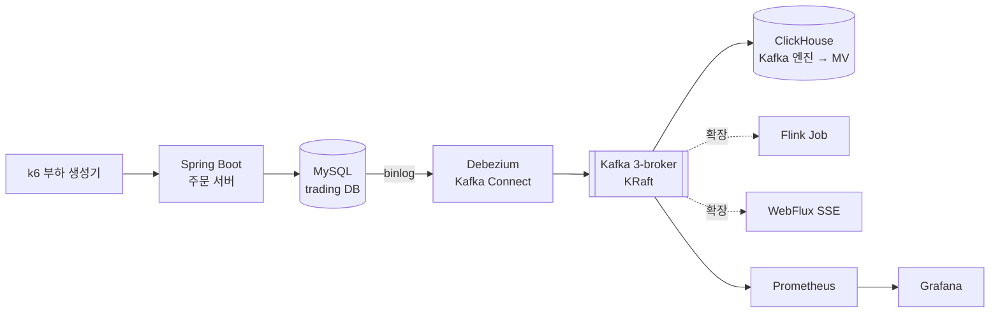

# Mini Trading Platform

MySQL 원장 DB → Debezium CDC → Kafka(3 브로커) → ClickHouse로 이어지는 실시간 파이프라인을 만들고,
**브로커 장애·재시작·부하 상황을 직접 재현해 정합성과 성능을 수치로 검증**하는 프로젝트입니다.


---

## ❔ 왜 이 프로젝트를 했나

증권 시스템에서 "주문이 DB에는 있는데 분석 시스템에는 없다"거나 "같은 체결이 두 번 집계됐다"는 건 곧 돈 문제입니다.
그래서 **데이터가 여러 시스템을 거쳐도 어긋나지 않는 구조**를 직접 만들고, 그 구조가 장애 상황에서도 정말 버티는지 숫자로 확인해 보고 싶었습니다.

이 프로젝트에서 답하려는 질문은 세 가지입니다.

| 질문 | 접근 |
|---|---|
| DB 저장과 이벤트 발행이 어긋나지 않게 하려면? | 애플리케이션이 DB·Kafka에 각각 쓰는 **dual write 대신 CDC**. 커밋된 변경만 binlog에서 읽어 발행 |
| 중복 이벤트가 들어와도 결과가 같으려면? | CDC·Kafka 소비는 at-least-once임을 전제로, ClickHouse `ReplacingMergeTree`로 **중복에 안전한 적재** |
| 설정을 바꾸면 실제로 뭐가 달라지나? | `acks`, `min.insync.replicas`, 파티션 수 등을 **같은 조건에서 전/후 수치로 비교** |

⚠️ 모든 실험은 운영 환경이 아닌 로컬 Docker 환경에서 수행한 **장애 재현 실험**입니다.

---

## 아키텍처



**주문 1건의 흐름**

1. k6가 `POST /orders`로 주문 요청
2. 주문 서버가 `orders`에 `ACCEPTED`로 저장 → 체결 시뮬레이터가 `executions` 생성
3. Debezium이 binlog를 읽어 `mts.trading.orders`, `mts.trading.executions` 토픽에 발행
4. ClickHouse Kafka 엔진이 소비 → Materialized View가 `ReplacingMergeTree`에 적재
5. 종목별 거래대금 등 분석 쿼리를 ClickHouse에서 조회

자세한 설계는 👉 [docs/ARCHITECTURE.md](docs/ARCHITECTURE.md)

---

## 🛠️ 기술 스택

모든 이미지는 정확한 버전으로 고정합니다 (`latest` 금지).

| 영역 | 기술 | 버전 | 선택 이유 |
|---|---|---|---|
| 주문 서버 | Java, Spring Boot, JPA | 21 / 3.x | |
| 원장 DB | MySQL | `8.4.8` | 8.0 지원 종료 → LTS인 8.4 |
| CDC | Debezium MySQL (Kafka Connect) | `3.6.2.Final` | binlog 기반, MySQL 8.4 지원 |
| 이벤트 버스 | Apache Kafka (KRaft, 3 브로커) | `4.3.1` | ZooKeeper 없는 공식 이미지 |
| 분석 저장소 | ClickHouse | `26.8.8.8` | 26.8 LTS, Kafka 엔진 내장 |
| 모니터링 | Prometheus, Grafana, kafka-exporter | | 처리량·지연·consumer lag 관측 |
| 부하 테스트 | k6 | | |
| 확장 | Flink, Spring WebFlux(SSE), Redis | | Phase 2 |

**Kafka 주요 설정**: RF 3 · `min.insync.replicas=2` · 파티션 6 · 토픽 자동 생성 비활성화

---

## ✅ 기능별 스펙 & 이슈

각 스펙의 "완료 기준"이 작업 단위이며, 스펙 하나가 GitHub 마일스톤 하나에 대응합니다. 마일스톤 링크에서 관련 이슈와 진행률을 볼 수 있습니다.

| # | 기능 | 스펙 | 이슈 | 상태 |
|---|---|---|---|---|
| 01 | 주문·체결 API, 체결 시뮬레이터, 부하 생성 | [01-order-server](docs/specs/01-order-server.md) | [M1](../../milestone/1) | ✅ |
| 02 | MySQL → Debezium → Kafka CDC | [02-cdc-pipeline](docs/specs/02-cdc-pipeline.md) | [M2](../../milestone/2) | ✅ |
| 03 | Kafka → ClickHouse 실시간 적재, 중복 처리 | [03-clickhouse-sink](docs/specs/03-clickhouse-sink.md) | [M3](../../milestone/3) | ✅ |
| 04 | 장애·부하 재현 실험 | [04-reliability-experiments](docs/specs/04-reliability-experiments.md) | [M4](../../milestone/4) | ✅ |
| 05 | 주문 내역 조회 쿼리 개선 | [05-query-optimization](docs/specs/05-query-optimization.md) | [M5](../../milestone/5) | ✅ |
| 06 | 확장 과제 (Flink, SSE, Redis) | [06-phase2-backlog](docs/specs/06-phase2-backlog.md) | [M6](../../milestone/6) | ⬜ |

<sub>상태: ⬜ 예정 · 🟨 진행 중 · ✅ 완료</sub>

---

## 🔎 실험 & 결과
**주요 발견**
 
- `acks=1`에서 리더 장애 시 **ack된 메시지 291건 유실**을 재현했고, `acks=all` + 멱등성으로 15회 모두 유실·중복 0건 (E1)
- 커넥터 강제 종료로 회당 약 2만 건 중복이 생겨도 MySQL과 ClickHouse `FINAL` 결과가 **7회 모두 일치** (E2)
- 조회 인덱스 하나로 대형 계좌 p95 **6.83s → 96ms**, 읽는 행 127만 → 20 (Q1)
- 병목을 수치로 추적: 커넥션 풀(L1) → ClickHouse 적재 간격(E0) → 플러그인 스캔(E2)
### 주문 API 성능 · [01-order-server](docs/specs/01-order-server.md)
 
| ID | 실험 | 핵심 결과 | 기록 |
|---|---|---|---|
| L1 | 주문 API 처리량 한계와 커넥션 풀 | 병목은 HikariCP 풀(10). 30으로 늘려 500 TPS에서 처리량 217 → **497/s**, p50 4.16s → **86ms** | [보기](experiments/results/20261019-L1-order-api-capacity/20261019-L1-order-api-capacity.md) |
 
### 조회 쿼리 개선 · [05-query-optimization](docs/specs/05-query-optimization.md)
 
| ID | 실험 | 핵심 결과 | 기록 |
|---|---|---|---|
| Q0 | 계좌별 주문 내역 조회 기준선 | 100만 행 풀스캔. 결과 3건인 계좌도 약 440ms로, 비용이 결과 수가 아닌 테이블 크기에 비례 | [보기](experiments/results/20261019-Q0-orders-history-baseline/20261019-Q0-orders-history-baseline.md) |
| Q1 | 인덱스 후보 4개 비교 | `(account_id, created_at)` 채택. 역방향 스캔으로 filesort 제거, 처리량 9.4 → **1,201/s** (127배). 커버링 인덱스는 정렬 순서가 어긋나 오히려 느림 | [보기](experiments/results/20261019-Q1-orders-history-index/20261019-Q1-orders-history-index.md) |
| W1 | 인덱스 추가의 쓰기 성능 영향 | 쓰기 비용은 실행 간 편차 이내 (407 vs 413/s). 2회만 쟀다면 "12% 하락"으로 오판할 뻔한 것을 재측정으로 배제. 인덱스 DDL은 CDC 이벤트 0건 | [보기](experiments/results/20261019-W1-index-write-impact/20261019-W1-index-write-impact.md) |
| P1 | OFFSET vs 커서 페이지네이션 | 깊이 40,000에서 OFFSET 195ms vs 커서 **23ms** (8.5배). 커서는 깊이와 무관하게 약 20ms | [보기](experiments/results/20261020-P1-pagination/20261020-P1-pagination.md) |
 
### 파이프라인 신뢰성 · [04-reliability-experiments](docs/specs/04-reliability-experiments.md)
 
| ID | 실험 | 핵심 결과 | 기록 |
|---|---|---|---|
| E0 | end-to-end 지연과 FINAL 비용 | 지연은 ClickHouse 묶음 간격이 좌우. 7.5s → 1s로 e2e p95 7.6s → **1.7s**. `FINAL`이 `argMax`보다 4~15배 빠름 | [보기](experiments/results/20261021-E0-e2e-latency/20261021-E0-e2e-latency.md) |
| E1 | 브로커 장애와 acks·멱등성 | `acks=1` 50k msg/s에서 **291건 유실**, `acks=all` 0건. 멱등성으로 중복·순서 역전 0. 연결 타임아웃 조정으로 쓰기 중단 22.3s → **9.5s** | [보기](experiments/results/20261021-E1-broker-failure-acks/20261021-E1-broker-failure-acks.md) |
| E2 | Debezium 커넥터 강제 종료와 중복 | kill 시 회당 약 2만 건 재발행, 정합성은 7회 모두 일치. 오프셋 저장 주기·플러그인 경로 조정으로 중복 **−91%**, 복구 82s → **42s** | [보기](experiments/results/20261023-E2-connector-restart-dup/20261023-E2-connector-restart-dup.md) |
| E4 | 파티션 수와 처리량 한계 | 파티션 3·6·12 모두 21~23만 rows/s로 같음. `kafka_thread_per_consumer=1`로 15.7만 → **23.4만**. 실제 경로 대비 약 100배 여유 | [보기](experiments/results/20261022-E4-partition-throughput/20261022-E4-partition-throughput.md) |
 
실험 기록은 `experiments/results/YYYYMMDD-<실험ID>.md`에 **가설 → 조건 → 결과 → 해석 → 조치** 순서로 남깁니다.


---

## 🚀 빠른 시작

**요구 사항**: Docker (메모리 **8GB 이상** 할당 권장)

```bash
cp .env.example .env          # 비밀번호 설정
docker compose up -d --wait   # 전체 스택 기동 (모든 컨테이너 healthy까지 대기)
./scripts/create-topics.sh    # 토픽 생성 (커넥터 등록 전에 실행)
```

| 서비스 | 호스트 접속 주소 |
|---|---|
| MySQL | `localhost:3307` |
| Kafka | `localhost:19092`, `29092`, `39092` |
| Kafka Connect | http://localhost:8083 |
| ClickHouse | http://localhost:8123, `localhost:9000` |

<details>
<summary>Windows(WSL2) 사용 시 주의사항</summary>

- 메모리는 Docker Desktop 화면이 아닌 `%UserProfile%\.wslconfig`의 `memory`로 지정합니다.
- 셸 스크립트·설정 파일은 LF 줄바꿈이어야 합니다 (`.gitattributes`로 강제).
- Windows 폴더를 마운트한 설정 파일은 MySQL이 무시하므로, MySQL 설정은 compose의 `command`로 전달합니다.

</details>

---

## 📁 디렉토리 구조

```
mini-trading-platform/
├── docker-compose.yml
├── infra/            # mysql, connect, clickhouse, prometheus, grafana 설정
├── order-server/     # Spring Boot 주문 서버
├── load-test/        # k6 스크립트
├── scripts/          # 토픽 생성 등 운영 스크립트
├── experiments/      # 실험 도구, 장애 주입 스크립트, 결과 기록
└── docs/             # ARCHITECTURE.md, specs/
```

---

## ✏️ 개발 규칙

- 이슈 → 브랜치 → 커밋 → PR 순서로 작업하며, main에 직접 커밋하지 않습니다.
- 커밋 메시지: `<type>(<scope>): <요약> (#이슈번호)` — 예: `feat(cdc): Debezium 커넥터 등록 (#12)`
- CI: `order-server` 빌드·테스트, `infra` 설정 검사(shellcheck, compose config), `commit-lint` 컨벤션 검사
