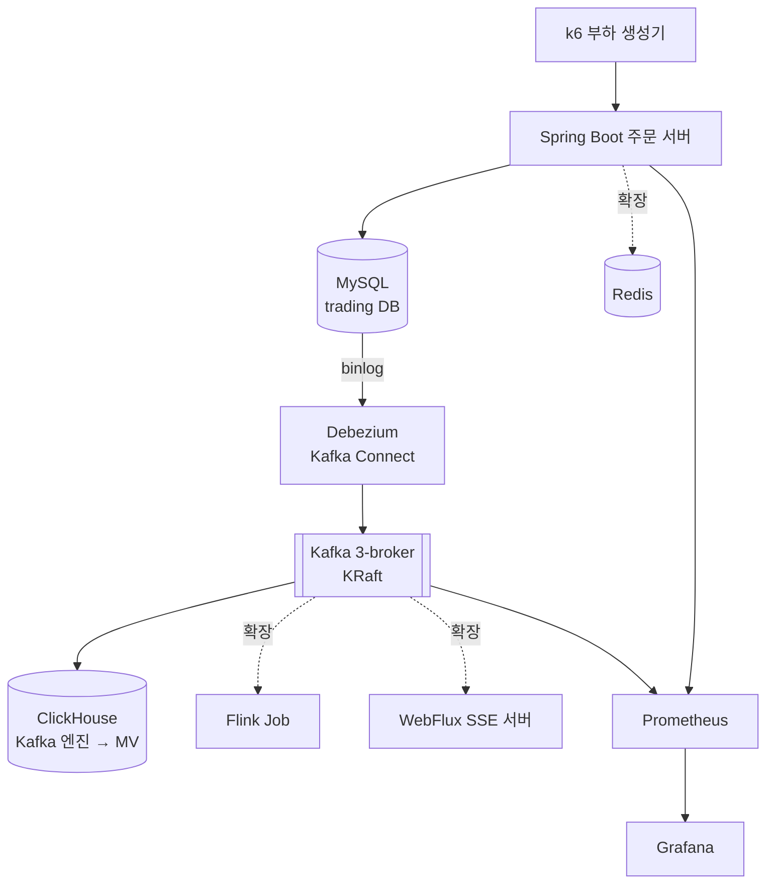

# Mini Trading Platform — 아키텍처

## 1. 개요

증권 주문·체결 원장 DB의 변경분을 CDC(Change Data Capture)로 Kafka에 전달하고, OLAP 저장소(ClickHouse)에 실시간으로 적재하는 데이터 파이프라인이다. 브로커 장애·재시작·부하 상황을 재현해 **정합성과 성능을 수치로 검증**하는 것을 목표로 한다.

### 설계 원칙

- **이벤트 발행의 원자성**: 애플리케이션이 DB와 Kafka에 각각 쓰지 않고(dual write), DB에 커밋된 변경만 binlog를 통해 발행한다.
- **중복을 전제로 한 적재**: CDC와 Kafka 소비는 at-least-once이므로, 다운스트림은 중복이 들어와도 결과가 같도록 설계한다.
- **측정 기반 개선**: 모든 설정 변경과 최적화는 같은 조건에서 측정한 전/후 수치로 기록한다.
- **재현 가능한 환경**: 모든 이미지 버전을 고정하고, `docker compose` 한 번으로 전체 스택을 띄운다.

## 2. 전체 구조



## 3. 컴포넌트

| 컴포넌트 | 역할 | 기술 | 범위 |
|---|---|---|---|
| order-server | 주문 접수, 체결 시뮬레이션, 조회 API | Java 21, Spring Boot 3, JPA | 핵심 |
| MySQL | 주문·체결 원장 DB (CDC 원천) | MySQL 8.4 LTS | 핵심 |
| Debezium | binlog 기반 CDC → Kafka | Kafka Connect + Debezium MySQL | 핵심 |
| Kafka | 이벤트 버스, 3 브로커 클러스터 | Apache Kafka (KRaft) | 핵심 |
| ClickHouse | 실시간 분석 저장소 | Kafka 엔진 + Materialized View | 핵심 |
| 모니터링 | 처리량·지연·lag 관측 | Prometheus, Grafana, kafka-exporter | 핵심 |
| 부하 생성 | 주문 트래픽 생성, API 성능 측정 | k6 | 핵심 |
| Flink Job | 종목별 실시간 집계 | Flink DataStream (Java) | 확장 |
| SSE 서버 | 체결 알림 실시간 푸시 | Spring WebFlux (Netty) | 확장 |
| Redis | 잔고 캐시 | Redis | 확장 |

## 4. 데이터 흐름 — 주문 1건의 일생

1. 클라이언트(k6)가 `POST /orders`로 주문을 보낸다.
2. order-server가 `orders`에 `status=ACCEPTED`로 저장한다.
3. 체결 시뮬레이터가 접수된 주문을 읽어 `executions`를 생성하고 `orders.status`를 갱신한다.
4. MySQL binlog를 Debezium이 읽어 `mts.trading.orders`, `mts.trading.executions` 토픽에 발행한다.
5. ClickHouse Kafka 엔진 테이블이 토픽을 소비하고, Materialized View가 `ReplacingMergeTree` 테이블에 적재한다.
6. 분석 쿼리(종목별 거래대금 등)를 ClickHouse에서 조회한다.

### 왜 dual write 대신 CDC인가

서버가 DB 저장 후 Kafka에 직접 발행하면, DB 커밋은 성공했지만 발행이 실패하거나(이벤트 유실) 발행은 됐지만 트랜잭션이 롤백되는(유령 이벤트) 불일치가 생길 수 있다. CDC는 **커밋된 변경만** binlog에서 읽어 발행하므로 DB 상태와 이벤트 스트림이 항상 일치한다. 대가로 발행 지연(binlog 읽기)과 Connect 운영 부담이 추가된다.

## 5. Kafka 설계

| 항목 | 값 | 비고 |
|---|---|---|
| 브로커 수 | 3 (KRaft combined mode) | 브로커와 컨트롤러를 한 프로세스에서 실행 (로컬 리소스 고려) |
| replication.factor | 3 | |
| min.insync.replicas | 2 | 실험 E1에서 1과 비교 |
| 파티션 수 | 6 | 실험 E4에서 3/6/12 비교 |
| 메시지 키 | 테이블 PK (Debezium 기본) | 계좌 단위 순서 보장은 확장 과제 |
| 토픽 자동 생성 | 비활성화 | `scripts/create-topics.sh`로 명시 생성. **커넥터 등록 전에 실행** |
| Connect 내부 토픽 | RF 3 | `CONNECT_*_STORAGE_REPLICATION_FACTOR`로 지정 (기본 설정 파일은 1) |

| 토픽 | 생산자 | 소비자 |
|---|---|---|
| `mts.trading.orders` | Debezium | ClickHouse |
| `mts.trading.executions` | Debezium | ClickHouse, (확장) Flink, SSE |
| `schema-history.mts` | Debezium | Debezium (파티션 1, 무기한 보존) |
| `connect-configs`, `connect-offsets`, `connect-status` | Kafka Connect 내부 | — |

### 리스너 구성

| 리스너 | 용도 | 주소 |
|---|---|---|
| INTERNAL | 컨테이너 간 통신 (Connect, ClickHouse) | `kafka-1:9092`, `kafka-2:9092`, `kafka-3:9092` |
| EXTERNAL | 호스트의 실험 도구 | `localhost:19092`, `29092`, `39092` |
| CONTROLLER | KRaft 컨트롤러 합의 | `kafka-N:9093` |

클라이언트는 처음 접속한 주소가 아니라 브로커가 알려주는 advertised 주소로 재접속하므로, 접속 위치별로 리스너를 분리한다.

## 6. 기술 스택 및 버전

모든 이미지는 **정확한 버전으로 고정**한다 (`latest` 태그 금지).

| 구성 | 이미지 / 버전 | 선택 이유 |
|---|---|---|
| Java / Spring Boot | 21 / 3.x | |
| MySQL | `mysql:8.4.8` | 8.0 지원 종료에 따라 LTS인 8.4 선택 |
| Kafka | `apache/kafka:4.3.1` | Apache 공식 이미지, KRaft 전용 |
| Debezium (Connect) | `quay.io/debezium/connect:3.6.2.Final` | Kafka 4.2 기준 빌드, MySQL 8.4 지원 |
| ClickHouse | `clickhouse/clickhouse-server:26.8.8.8` | 26.8 LTS |
| k6 | — | |

## 7. 디렉토리 구조

```
mini-trading-platform/
├── docker-compose.yml
├── infra/
│   ├── mysql/init/       # DDL, Debezium 계정 (서버 설정은 compose의 command)
│   ├── connect/          # 커넥터 설정 JSON, 등록 스크립트
│   ├── clickhouse/init/  # init SQL (Kafka 엔진, MV, 타깃 테이블)
│   ├── prometheus/
│   └── grafana/
├── order-server/         # Spring Boot
├── load-test/            # k6 스크립트
├── scripts/              # 토픽 생성 등 운영 스크립트
├── experiments/
│   ├── producer-tool/    # acks 실험용 Java 프로듀서
│   ├── scripts/          # 장애 주입 스크립트
│   └── results/          # 실험 결과 기록
└── docs/
    ├── ARCHITECTURE.md
    └── specs/            # 기능별 상세 설계
```

## 8. 실행 환경

### 실행

```bash
cp .env.example .env        # 비밀번호 설정
docker compose up -d --wait # 전체 스택 기동 (모든 컨테이너 healthy까지 대기)
./scripts/create-topics.sh  # 토픽 생성
```

### 리소스

Kafka 3대 + Connect + ClickHouse는 메모리를 많이 쓴다. Docker에 **최소 8GB** 할당을 권장하고, 각 컨테이너의 메모리와 JVM 힙을 명시적으로 제한한다.

| 컨테이너 | 메모리 상한 | 유휴 시 실측 | 호스트 접속 |
|---|---|---|---|
| mts-mysql | 1GB | 454MiB | `localhost:3307` (로컬 MySQL과 충돌 방지) |
| mts-kafka-1~3 | 1GB × 3 | 479~565MiB | `localhost:19092`, `29092`, `39092` |
| mts-connect | 1.5GB | 735MiB | `http://localhost:8083` |
| mts-clickhouse | 2GB | 190MiB | `http://localhost:8123`, `localhost:9000` |
| **합계** | **7.5GB** | **약 2.9GiB** | |

### Windows(WSL2) 환경 주의사항

- 메모리는 Docker Desktop 화면이 아닌 `%UserProfile%\.wslconfig`의 `memory`로 지정한다.
- 셸 스크립트·설정 파일은 LF 줄바꿈이어야 한다 (`.gitattributes`로 강제). CRLF면 컨테이너에서 `bash\r` 오류.
- Windows 폴더를 마운트한 설정 파일은 world-writable로 보여 MySQL이 무시한다 → MySQL 설정은 실행 옵션으로 전달.

## 9. 상세 설계

| 문서 | 내용 |
|---|---|
| [01-order-server](specs/01-order-server.md) | 주문·체결 API, 체결 시뮬레이터, 부하 생성 |
| [02-cdc-pipeline](specs/02-cdc-pipeline.md) | MySQL → Debezium → Kafka |
| [03-clickhouse-sink](specs/03-clickhouse-sink.md) | Kafka → ClickHouse 실시간 적재, 중복 처리 |
| [04-reliability-experiments](specs/04-reliability-experiments.md) | 장애·부하 재현 실험 |
| [05-query-optimization](specs/05-query-optimization.md) | 주문 내역 조회 쿼리 개선 |
| [06-phase2-backlog](specs/06-phase2-backlog.md) | 확장 과제 |

## 10. 실험 기록 방식

모든 실험은 `experiments/results/YYYYMMDD-<실험ID>.md`에 아래 형식으로 남긴다. 운영 환경이 아닌 로컬에서 재현한 실험임을 문서에 명시한다.

- **가설**: 무엇이 일어날 거라 예상했는가
- **조건**: 설정값, 데이터량, TPS
- **결과**: 수치, 그래프 캡처
- **해석**: 왜 그런 결과가 나왔는가, 예상과 달랐다면 왜인가
- **조치**: 무엇을 바꿨고 그 후 수치는 어떻게 변했는가
