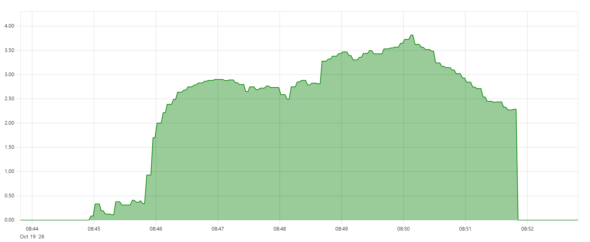
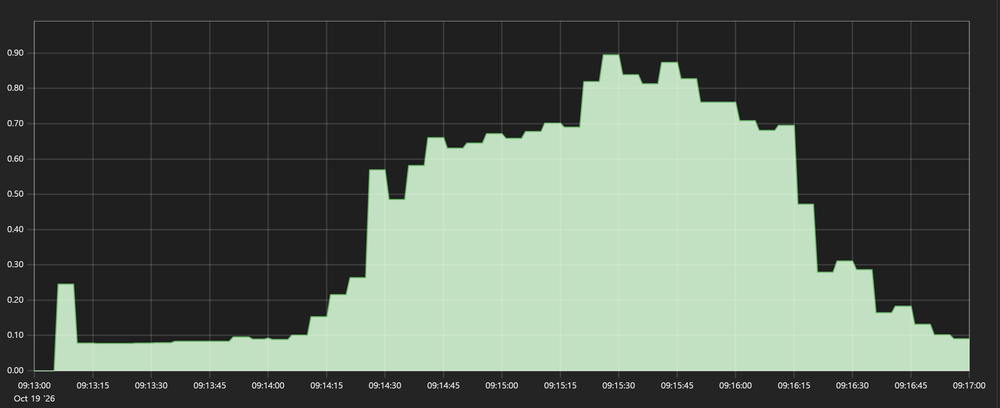
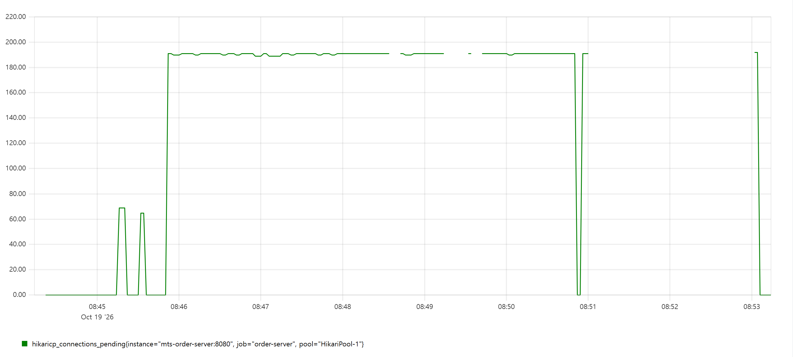
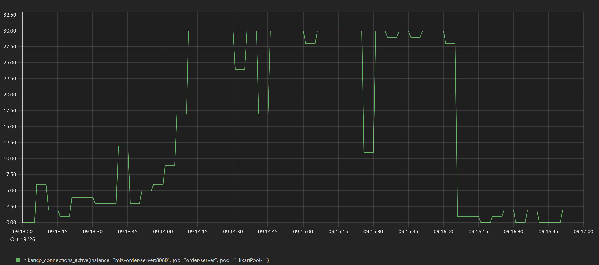
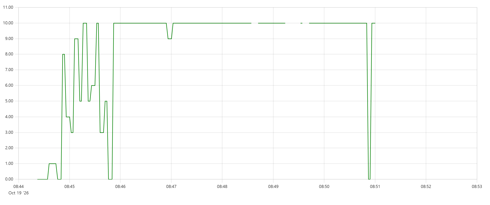

# L1. 주문 접수 API 처리량 한계와 커넥션 풀

## 가설
주문 접수는 한 트랜잭션에서 쿼리 3번(종목 확인, 계좌 확인, INSERT)을 하고,
체결 시뮬레이터 워커 2개도 커넥션을 쓴다. HikariCP 기본 풀(10개)이 먼저 포화되어
처리량 상한이 생길 것이다.
 
## 조건
| 항목 | 값 |
|---|---|
| 환경 | 로컬 WSL2 Docker. k6·order-server·MySQL·Kafka가 같은 PC의 같은 Docker 네트워크 |
| order-server | 컨테이너(`eclipse-temurin:21-jre`, 메모리 1GB), 체결 시뮬레이터 켬 (워커 2, 100ms, 배치 50) |
| MySQL | 8.4.8, 메모리 1GB, `innodb_flush_log_at_trx_commit=1`, `sync_binlog=1` |
| 데이터 | 시드 주문 100만 건 (계좌 1만, 종목 100) |
| 부하 | k6 2.3.0 `constant-arrival-rate`, `POST /orders`, 계좌 균등, 종목 상위 10개에 50% |
| 단계 | 100 TPS 1분(워밍업) → 500 TPS (풀 10: 5분 / 풀 30: 2분) → 1,000 TPS 2분(풀 10만) |
| 서버 지표 | Prometheus 5초 수집, `hikaricp_connections_active/pending` |
 
## 결과
 
### 풀 10 (기본값)
| 목표 TPS | 처리량 | p50 | p95 | p99 | 건너뛴 요청 | 커넥션 사용 / 대기 최고 |
|---|---|---|---|---|---|---|
| 100 | 98.6/s | 43ms | 372ms | 941ms | 70 | 10 미만 / 거의 없음 |
| 500 | 217/s | 4.16s | 7.29s | 9.69s | 83,958 (276/s) | 10 / 190 |
| 1,000 | 229/s | 8.1s | 12.44s | 14.73s | 90,388 (699/s) | 10 / 큼 |
 
에러율은 모든 단계 0%.
 
### 풀 10 → 30 (500 TPS)
| 지표 | 풀 10 | 풀 30 |
|---|---|---|
| 처리량 | 217/s | **497/s** |
| p50 | 4.16s | **86ms** |
| p95 | 7.29s | **790ms** |
| p99 | 9.69s | 1.42s |
| 건너뛴 요청 | 276/s | 3.2/s |
| 커넥션 사용 / 대기 최고 | 10 / 190 | 30 / 170 (순간) |
| CPU (500 TPS 중) | - | MySQL 22%, order-server 13% |
 
원본 출력: [`raw/20261019-L1-k6-pool10.txt`](raw/20261019-L1-k6-pool10.txt), [`raw/20261019-L1-k6-pool30.txt`](raw/20261019-L1-k6-pool30.txt)
 
## 그래프 (Prometheus)
 
| 지표 | 풀 10 (08:44~08:53) | 풀 30 (09:13~09:17) |
|---|---|---|
| 서버 측 p95 (초) |  |  |
| 커넥션 대기 (`pending`) |  |  |
| 사용 중 커넥션 (`active`) |  |  |
 
## 해석
 
### 병목은 커넥션 풀
- 풀 10에서는 목표를 500 → 1,000으로 올려도 처리량이 217 → 229로 거의 그대로이고 응답 시간만 2배가 됐다.
  처리량(217/s) × 평균 응답(4.5s) ≈ 977건이 동시 대기 중으로, k6 최대 VU 1,000과 일치한다. 전형적인 포화 상태.
- 100 TPS에서는 커넥션이 10개에 닿지 않았고, 500 TPS에서 10개가 모두 차면서 대기열이 생겼다.
  커넥션이 상한에 닿는 시점과 처리량이 멈추는 시점이 같다.
- 풀을 30으로 늘리자 처리량이 2.3배, p50이 약 48배 개선되어 병목이 커넥션 풀이었음을 확인했다.
### 대기 상한 = Tomcat 스레드 200 − 풀 크기
- 대기 최고값이 풀 10에서 190, 풀 30에서 170이다. Tomcat 요청 스레드 기본값 200에서 커넥션을 쥔 스레드를 뺀 값과 정확히 같다.
- 풀 10에서는 500 TPS 5분 내내 대기가 190에 붙어 있었다. 200개 스레드 전부가 커넥션을 쥐거나 기다리는 상태가 계속됐다는 뜻이다.
- 풀 30에서는 대기가 평소 0이다가 약 15초 간격으로 170까지 튄다. 그 순간 모든 스레드가 잠깐 멈춘 것이며,
  p95 꼬리(790ms)는 평소 처리 속도가 아니라 이 주기적 멈춤에서 온다.
### 서버 지표는 스레드 대기 이전의 지연을 보지 못한다
- 풀 10에서 서버 측 p95는 약 2.7~3.8초인데 k6 p95는 7.29초로 약 4초 차이가 난다. 풀 30에서는 차이가 거의 없다.
- 서버는 요청이 스레드에 배정된 뒤부터 시간을 잰다. 스레드 200개가 모두 차면 새 요청은 배정 전에 Tomcat 앞에서 기다리고,
  이 시간은 서버 지표에 잡히지 않는다. 포화 시 서버 지표만 보면 실제 사용자 지연을 절반 이하로 보게 된다.
### 디스크 커밋은 이 부하에서 한계가 아니었다
- 커밋마다 fsync하는 설정(`=1`)이라 디스크 대기를 다음 병목으로 의심했으나, 500 TPS를 처리했고 CPU도 MySQL 22%, 서버 13%로 여유가 있었다.
  서버 시작 이후 누적값 기준 커밋 425,545회에 redo 로그 fsync 334,640회로, 동시 커밋을 fsync 한 번에 묶는 group commit이 동작하고 있었다.
### 모니터링의 사각지대
- 에러율 0%만으로는 포화를 알 수 없었다 (풀 10, 500 TPS도 threshold 통과). 처리량, `dropped_iterations`, 응답 시간을 함께 봐야 한다.
- 풀 10에서는 그래프가 군데군데 끊기고 1,000 TPS 구간은 거의 수집되지 않았다. 지표 엔드포인트가 주문 요청과 같은 Tomcat 스레드를 써서,
  수집 요청도 줄을 서다 시간 초과로 실패했다. 가장 심하게 밀린 순간에 모니터링이 먼저 꺼진다. 풀 30에서는 끊기지 않았다.
## 조치
- `spring.datasource.hikari.maximum-pool-size`를 30으로 설정.

## 남은 과제
- 풀 30에서 약 15초 주기로 모든 스레드가 멈추는 원인 확인. 
  - 후보 1: JVM GC(`jvm_gc_pause_seconds`)
  - 후보 2: MySQL 체크포인트
- 지표 수집용 관리 포트 분리(`management.server.port`)로 포화 시에도 모니터링 유지
- k6 threshold에 `dropped_iterations`, 응답 시간 조건 추가 (에러율만으로는 포화를 못 잡음)
