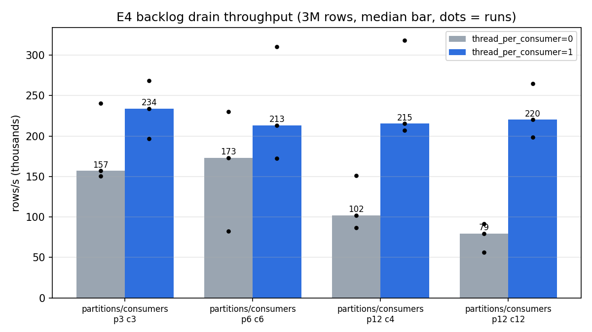
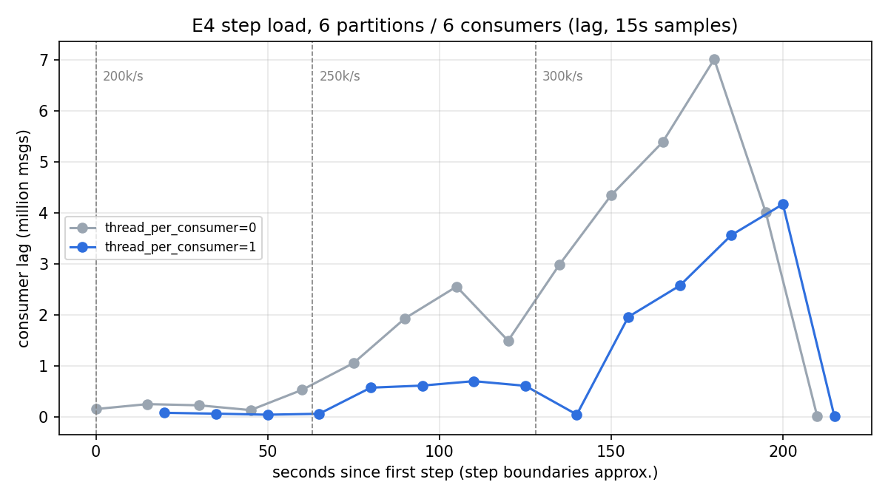

# E4. 파티션 수와 처리량 한계 (부하 재현 실험)

> 로컬 Docker 환경(4코어)에서 재현한 실험이다. 실서비스 측정 기록이 아니다.

## 요약

| 항목 | 결과 |
|---|---|
| 파티션 수 | 3 → 6 → 12로 늘려도 최대 소비 처리량은 **21~23만 rows/s로 같음**. 파티션은 이 규모에서 병목이 아님 |
| 적재 방식 | ClickHouse Kafka 엔진 기본값(`kafka_thread_per_consumer=0`)은 컨슈머를 늘릴수록 **15.7만 → 7.9만 rows/s로 감소**. 컨슈머별 병렬 적재(`=1`)는 파티션 수와 무관하게 21~23만 |
| lag 누적 시작 | 생산·소비 동시 상황에서 기본값 **20~25만**, 병렬 적재 **25~30만 msg/s** 사이 |
| 병목 | 단일 호스트 4코어를 프로듀서·브로커·ClickHouse가 나눠 씀. 기본값에서는 그 전에 단일 적재 스레드가 먼저 막힘 |
| 실제 경로 | 주문 API 한계 약 500 TPS(L1) ≈ 약 2,200 events/s → 소비 한계 대비 약 100배 여유. 실제 병목은 앞단(order-server·MySQL) |

## 배경

주문 API를 통한 부하는 order-server가 약 500 TPS에서 먼저 포화되므로(L1), 파티션 수의 영향이 드러나지 않는다. 그래서 프로듀서 도구로 **실제 체결 CDC 메시지와 같은 형식**(키 `{"id":N}`, 10개 필드 JSON)을 실험 전용 토픽에 직접 넣어, Kafka → ClickHouse 구간의 한계를 측정했다. 운영 토픽은 키 분포와 Debezium 오프셋에 영향을 주므로 건드리지 않았다.

## 가설

| # | 가설 |
|---|---|
| H1 | 컨슈머 수 = 파티션 수일 때, 파티션 3 → 6에서는 처리량이 오르고 12에서는 정체 (CPU 4코어가 다음 상한) |
| H2 | `kafka_thread_per_consumer=0`이면 파티션·컨슈머를 늘려도 처리량이 거의 오르지 않음 (여러 컨슈머의 데이터를 한 스레드에서 묶어 적재) |
| H3 | 실제 파이프라인의 한계는 Kafka·ClickHouse가 아니라 order-server |

## 조건

| 항목 | 값 |
|---|---|
| 호스트 | Docker 4코어, 8GB. 브로커 3대·ClickHouse·MySQL·Connect·프로듀서가 같은 코어를 공유 |
| 토픽 | 실험 전용 `e4.p3`, `e4.p6`, `e4.p12` (RF 3), 각 300만 건. 프로듀서 `acks=all`, 멱등성, lz4 압축 |
| ClickHouse 적재 | 운영 큐와 같은 스키마·설정 (묶음 10000, flush 1000ms, 대상 `ReplacingMergeTree`) |
| 변수 | 파티션 수, 컨슈머 수(`kafka_num_consumers`), `kafka_thread_per_consumer` |
| 컨슈머 수 제한 | ClickHouse는 기본적으로 컨슈머 수를 코어 수 이하로 제한 → `kafka_disable_num_consumers_limit = 1` |

### 측정 1: 백로그 소진 (최대 소비 처리량)

토픽에 300만 건을 미리 채운 뒤 새 컨슈머 그룹으로 Kafka 엔진 + MV를 붙이고, **첫 메시지를 읽은 시각부터 300만 행 적재 완료까지**의 시간으로 처리량을 계산했다. 그룹 참여·재배정 시간(1~3.5초)은 분리했다. 조합당 3회.

### 측정 2: 단계 부하 (lag 누적 시작 지점)

파티션 6, 컨슈머 6에서 ClickHouse를 먼저 붙여 두고 프로듀서 속도를 단계적으로 올렸다 (단계당 60초). kafka-exporter의 컨슈머 lag(5초 해상도)가 **일정 수준에서 멈추는지, 계속 늘어나는지**로 판단했다.

## 결과

### 측정 1: 백로그 소진



| 파티션 | 컨슈머 | tpc=0 (rows/s, 3회) | 중앙값 | tpc=1 (rows/s, 3회) | 중앙값 |
|---|---|---|---|---|---|
| 3 | 3 | 150,519 / 157,051 / 240,596 | 157,051 | 233,754 / 196,463 / 268,432 | **233,754** |
| 6 | 6 | 82,225 / 173,160 / 229,885 | 173,160 | 213,219 / 172,324 / 310,205 | **213,219** |
| 12 | 4 | 86,710 / 150,821 / 102,009 | 102,009 | 215,362 / 206,796 / 318,167 | **215,362** |
| 12 | 12 | 56,428 / 79,411 / 91,555 | **79,411** | 220,102 / 198,636 / 264,947 | **220,102** |

| 관찰 | 내용 |
|---|---|
| 회차 편차 | 8개 조합 중 7개에서 3회차가 가장 빠름 (실행 순서에 따른 환경 변화로 추정, 원인 미확인). 그래서 절대값은 중앙값, 비교는 **같은 회차 안에서 짝지어** 판단 |
| tpc 0 vs 1 | 같은 회차 안 비교에서 tpc=1이 **12쌍 중 11쌍** 빠름 (1쌍 동률) |
| 컨슈머 12개 + tpc=0 | 3회 모두 tpc=0 조합 중 최하위 |
| ClickHouse CPU (소진 중 평균) | tpc=0: 98~198%, tpc=1: 193~233% (최대 400%) |
| 컨슈머 할당 | 종료 시점 `system.kafka_consumers`에서 컨슈머별 읽은 수 = 파티션별 적재 수로 정확히 일치 |

### 측정 2: 단계 부하



| 생산 속도 | tpc=0 lag | 판정 | tpc=1 lag | 판정 |
|---|---|---|---|---|
| 5만 msg/s | 2~10만 | 따라감 | 2~3만 | 따라감 |
| 10만 msg/s | 50만 → 107만 | 증가 후 정체 (아래 참고) | 5~8만 | 따라감 |
| 15만 msg/s | 약 110만 유지 | 따라감 | 3~12만 | 따라감 |
| 20만 msg/s | 1차 100~119만 / 2차 13~25만 | 따라감 | 4~12만 | 따라감 |
| 25만 msg/s | 52만 → 193만 → 255만 → 299만 | **계속 증가** | 57만 → 61만 → 70만 → 60만 | 따라감 (약 2.5초 분량) |
| 30만 msg/s | 435만 → 539만 → 701만 | 계속 증가 | 196만 → 257만 → 356만 → 417만 | **계속 증가** |
| 마지막 단계 후 소진 | 25초 | | 11초 | |

- 1차: 5만~20만 msg/s, 2차: 20만~30만 msg/s (각 조합 1회)
- 포화 시 소비 속도: tpc=0 약 21~23만, tpc=1 약 23~24만 msg/s → 측정 1의 tpc=1 중앙값(21~23만)과 일치
- 모든 단계에서 전송 시도 = ack, 실패 0. 30만 단계는 67~68초 걸려 프로듀서도 한계 근처

| 포화 구간 CPU (평균) | 20만 | 25만 | 30만 |
|---|---|---|---|
| ClickHouse (tpc=0) | 159% | 182% | 175% |
| ClickHouse (tpc=1) | 157% | 193% | 193% |
| 브로커 3대 합 | 105~115% | 100~105% | 100~108% |

프로듀서 컨테이너는 측정 대상(`mts-*`) 밖이라 CPU가 기록되지 않았다.

## 해석

| 가설 | 판정 | 근거 |
|---|---|---|
| H1 | **기각** | tpc=1에서 파티션 3·6·12가 21~23만으로 같다. 파티션 3개(컨슈머 3개)부터 이미 CPU 상한 근처라, 파티션이 소비 병렬도의 상한이 되기 전에 CPU가 먼저 막힌다. 파티션 수는 "병렬도를 허용하는 상한"일 뿐, 늘린다고 처리량이 오르지 않는다 |
| H2 | **채택 (예상보다 강함)** | 안 오르는 정도가 아니라 컨슈머가 많을수록 떨어졌다 (15.7만 → 7.9만). 기본값은 여러 컨슈머가 읽은 데이터를 한 스레드가 돌아가며 모아 적재하므로, 컨슈머가 늘수록 수집·전환 비용만 늘고 CPU는 다 쓰지 못한다 (평균 100~130%) |
| H3 | **채택** | 주문 1건 = CDC 이벤트 약 4.4건(접수 1 + 체결 약 3.4)이라 L1 한계 약 500 TPS는 약 2,200 events/s. 소비 한계(20만 이상)의 약 1% |
| 누적 시작 지점 | 기본값 20~25만, 병렬 적재 25~30만 msg/s | 생산·브로커·소비가 같은 4코어를 쓰는 상태라 소진 실험보다 차이가 작다. 포화 시 ClickHouse는 약 190%, 브로커 합은 약 105%, 나머지는 프로듀서가 쓴 것으로 보여 **호스트 CPU 포화**가 최종 상한 |

### 측정 방식 보정 (실험 중 발견)

| 문제 | 영향 | 조치 |
|---|---|---|
| `ingested_at DEFAULT now64(3)`은 쿼리 안에서 상수라 **삽입 쿼리 시작 시각**이 기록됨 | 쿼리가 파티션 배정을 기다리는 동안 시작되면 그 대기(약 15초)가 섞여 처리량이 7.9만으로 과소평가 | 시작 시각을 `system.kafka_consumers.num_messages_read` 기준으로 변경 |
| 같은 컨슈머 그룹 이름 재사용 | 이전 실행이 커밋한 오프셋부터 읽어 0건 | 그룹 이름에 시각을 붙임 |
| 단계 부하에서 단계마다 id가 1부터 시작 | `ReplacingMergeTree`가 머지 때 같은 id를 합쳐 `count()`가 실제 소비량보다 적음 (Kafka lag는 정상) | 프로듀서에 `--id-offset` 추가 |

## 조치 (권장)

| 조치 | 근거 | 상태 |
|---|---|---|
| 운영 큐 `mts.kafka_executions_queue`에 `kafka_thread_per_consumer = 1` | 같은 컨슈머 수에서 소진 처리량 중앙값 15.7만 → 23.4만 rows/s (파티션 3 기준), lag 누적 시작 20~25만 → 25~30만 msg/s | 미적용. 적용 후 E0 end-to-end 지연 재측정 필요 |
| 파티션 수는 6 유지 | 이 규모에서 파티션은 병목이 아님. 늘리면 브로커·컨슈머 관리 비용만 증가 | 유지 |

## 한계

| 항목 | 내용 |
|---|---|
| 자원 공유 | 프로듀서·브로커·ClickHouse가 한 호스트 4코어를 나눠 씀. 실서비스처럼 분리하면 한계와 병목 위치가 달라짐 |
| 회차 편차 | 소진 처리량이 회차마다 최대 2.8배 차이 (예: 8.2만 ~ 23.0만). 원인 미확인 |
| 단계 부하 회차 | 조합당 1회(1차·2차). 1차 tpc=0에서 10만 단계에 쌓인 lag 약 110만이 20만까지 유지됐는데, 2차 같은 20만 단계는 13~25만이었다. 재현되지 않아 tpc=0의 **지연** 차이는 단정하지 않음 |
| 해상도 | kafka-exporter 5초, 오프셋은 묶음 단위로 커밋돼 `rate()` 값이 들쭉날쭉. 판단은 lag 추이로 함 |
| CPU 측정 | `docker stats` 표본이 1~2초 간격, 프로듀서 컨테이너는 미측정 |
| 지연 p95 | `ingested_at`이 쿼리 시작 시각이라 행 단위 end-to-end 지연을 정확히 잴 수 없어, lag(건수)로 대신함 |

## 남은 과제

- 운영 큐에 `kafka_thread_per_consumer = 1` 적용 후 E0 end-to-end 지연 재측정
- E0의 `ingested_at − kafka_ts` 지연 측정이 같은 `now64()` 성질의 영향을 받는지 확인 (flush 1초라 오차는 작을 것으로 예상)
- 회차 편차 원인 (페이지 캐시, 머지 등)

## 재현

```bash
(cd experiments/producer-tool && ./gradlew installDist)
# 측정 1
bash experiments/scripts/e4-prefill.sh <partitions>
bash experiments/scripts/e4-drain.sh <partitions> <consumers> <thread_per_consumer> <run>
# 측정 2
bash experiments/scripts/e4-step.sh 6 6 <thread_per_consumer>
SUFFIX=high RATES="200000 250000 300000" bash experiments/scripts/e4-step.sh 6 6 <thread_per_consumer>
```

| 폴더 | 내용 |
|---|---|
| `raw/prefill-p<P>/` | 적재 로그, 파티션별 오프셋, 건수 검증 |
| `raw/drain-p<P>-c<C>-tpc<T>-r<N>/` | `summary.txt`, `drain.csv`(경과·읽은 수·행 수), `stats.csv`(컨테이너 CPU), `kafka-consumers-*.tsv`(할당), `parts.tsv` |
| `raw/step-p6-c6-tpc<T>[-high]/` | `steps.csv`, `lag.csv`, `produce-rate.csv`, `consume-rate.csv`, `stats.csv`, 단계별 프로듀서 로그 |
| `img/` | 그래프 |
