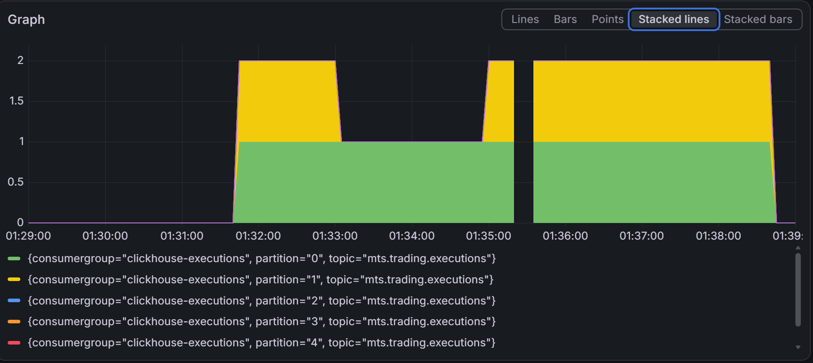
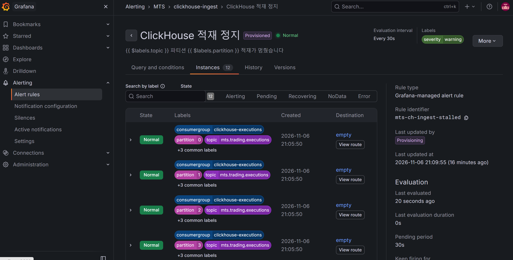
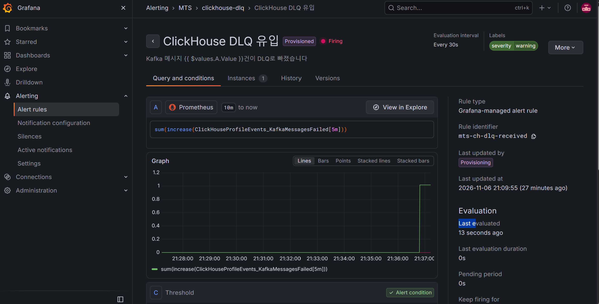

# K2. 처리할 수 없는 메시지와 적재 정지

07 스펙의 K2 실험 결과다.
로컬 docker compose 환경에서 수행한 장애 재현 실험이다.
관련 이슈는 #65이고, 운영 설정 반영과 재처리 절차는 #66에서 한다.

## 가설

형식이 잘못된 메시지 하나가 들어오면 기본 설정에서는 #49처럼 같은 위치를 반복하며 적재가 멈춘다.
ClickHouse의 `kafka_handle_error_mode`로 문제 메시지를 따로 빼면 나머지는 계속 적재된다.

실험 설계 중 추가한 가설은 다음과 같다.
깨진 메시지는 파티션 하나에만 들어가므로 그 파티션을 맡은 컨슈머만 멈추고, 이 부분 정지는 토픽 합계로 판단하는 알림 #54로 잡히지 않는다.

## 조건

| 항목 | 값 |
|---|---|
| ClickHouse | 26.8.8.8 |
| 대상 | 체결 큐 `kafka_executions_queue` |
| 컨슈머 | 3개, `kafka_thread_per_consumer = 1` |
| 부하 | k6 `orders.js`, `RATE=80` |
| 워밍업 | 30초 |
| 관찰 | 주입 후 300초 |
| 깨진 메시지 키 | `{"account_id":1}` (항상 파티션 0) |
| 실행 스크립트 | `k2-run.sh`, `k2-set-error-mode.sh`, `k2-inject.sh` |

### 깨진 메시지

| 종류 | 표식 id | 내용 |
|---|---|---|
| 문법 오류 (`malformed`) | 900000001 | 닫는 중괄호가 없는 JSON |
| 타입 오류 (`type`) | 900000002 | `quantity`가 문자열 `"abc"` |

#### 두 종류를 넣은 이유
- Debezium은 문법이 깨진 JSON을 만들지 않는다.
- 실제로 더 일어날 법한 경우는 컬럼 타입 변경 같은 타입 불일치다.

### 모드

| 모드 | 큐 설정 | 본 MV | 깨진 메시지가 가는 곳 |
|---|---|---|---|
| `default` | 없음 | 그대로 | 없음 |
| `stream` | `stream` | 그대로 | 없음 |
| `stream-filtered` | `stream` | `WHERE length(_error) = 0` 추가 | 오류 테이블 `k2_execution_errors` |
| `dead_letter_queue` | `dead_letter_queue` | 그대로 | `system.dead_letter_queue` |

#### `stream`을 거름 조건 없이 따로 둔 이유
- 모드만 바꾸고 MV를 고치지 않았을 때 무슨 일이 생기는지 확인하기 위해서다.

### 측정

| 항목 | 방법 |
|---|---|
| 정지 여부 | 관찰 끝 표식 파티션의 커밋 오프셋이 표식을 지났는지 |
| 부분 정지 | 파티션별 lag (`producer-tool lag`) |
| 예외 | `system.kafka_consumers`의 예외 문구 |
| 알림 | 알림 #54의 조건식을 Prometheus에 2초마다 직접 계산 |
| 회복 | 관찰 뒤에도 멈춰 있으면 `dead_letter_queue`로 바꾸고 lag 0까지 시간 |
| 정합성 | MySQL과 ClickHouse 체결 건수 (표식, 기본값 행 제외) |

#### 알림을 Prometheus로 계산한 이유
- 실험 시작 시점에 Grafana의 프로비저닝 폴더가 비어 있어 알림 규칙이 로드되지 않은 상태였다.
    - Docker Desktop 재시작 때 바인드 마운트가 빈 폴더로 붙었고, 실험 도중 Grafana를 다시 만들어 복구했다.
- 조건식을 그대로 계산하면 Grafana 상태와 관계없이 "알림이 울렸을 상황인지"를 판단할 수 있다.
- 알림은 조건이 30초 이상 이어질 때 울리므로, 2초 샘플이 15개 이상 연속이면 울렸을 상황으로 본다.

## 결과

### 모드별 결과

| 모드 | 종류 | 표식 파티션 | 표식 파티션 최대 lag | 예외 컨슈머 | 기본값 행 | 정합성 |
|---|---|---|---|---|---|---|
| `default` | 문법 | 멈춤 | 18095 | 3 | 0 | 일치 |
| `default` | 타입 | 멈춤 | 21673 | 3 | 0 | 일치 |
| `stream` | 문법 | 멈춤 | 21405 | 3 | 0 | 일치 |
| `stream` | 타입 | 멈춤 | 20677 | 3 | 0 | 일치 |
| `stream-filtered` | 문법 | 지나감 | 220 | 0 | 0 | 일치 |
| `stream-filtered` | 타입 | 지나감 | 800 | 0 | 0 | 일치 |
| `dead_letter_queue` | 문법 | 지나감 | 122 | 0 | 0 | 일치 |
| `dead_letter_queue` | 타입 | 지나감 | 117 | 0 | 0 | 일치 |

### 부분 정지

- 멈춘 네 실행 모두 표식 파티션 0 다음으로 lag가 큰 파티션은 파티션 1이었다.
    - 파티션 0과 1은 같은 컨슈머(`-0`)가 맡는다.
- 파티션 2~5를 맡은 두 컨슈머는 계속 커밋했다.

### 알림 조건 충족

| 실행 | 부하 중 | 부하를 멈춘 뒤 |
|---|---|---|
| `default` 문법 | 0 / 143 | 15 / 75 |
| `default` 타입 | 0 / 164 | 20 / 75 |
| `stream` 문법 | 0 / 163 | 40 / 95 |
| `stream` 타입 | 0 / 145 | 16 / 70 |
| 나머지 네 실행 | 0 | 0 |

### 예외 문구

| 컨슈머 | 담당 파티션 | 기록된 예외 | 실제 상태 |
|---|---|---|---|
| `-0` | 0, 1 | 파티션 0, 오프셋 4970414 파싱 실패 | 멈춤 |
| `-1` | 2, 3 | 같은 예외 | 계속 적재 |
| `-2` | 4, 5 | 같은 예외 | 계속 적재 |

- `default` 문법 오류 실행의 기록이다.
- 예외는 컨슈머마다 최근 10개만 남았고, 1~2초 간격의 재시도로 모두 같은 예외로 채워졌다.

### 깨진 메시지가 남은 곳

| 모드 | 위치 | 남은 정보 |
|---|---|---|
| `stream-filtered` | `mts.k2_execution_errors` | 토픽, 파티션, 오프셋, 원본, 오류 |
| `dead_letter_queue` | `system.dead_letter_queue` | 토픽, 파티션, 오프셋, 키, 원본, 오류 |

- 회복 단계에서 `dead_letter_queue`로 넘긴 네 건도 모두 `system.dead_letter_queue`에 남았다.
- 두 위치 모두 표식 메시지의 원본을 잘린 데 없이 그대로 담았다.

### 회복

| 실행 | 회복 직전 체결 lag | DLQ 전환 후 lag 0까지 |
|---|---|---|
| `default` 문법 | 28239 | 46.8초 |
| `default` 타입 | 23360 | 48.3초 |
| `stream` 문법 | 40588 | 92.8초 |
| `stream` 타입 | 21362 | 148.0초 |

- `stream` 타입 실행은 PC 절전으로 시각이 크게 벌어진 실행이라 회복 시간을 신뢰하기 어렵다.

## 해석

#### 기본 설정에서 적재가 멈춘 이유
- Kafka 엔진은 메시지를 파싱하지 못하면 예외를 내고 오프셋을 커밋하지 않는다.
- 다음 시도에서 같은 위치를 다시 읽어 같은 예외가 나므로, 그 컨슈머는 영원히 앞으로 가지 못한다.
- 문법 오류와 타입 오류 모두 같았다.

#### `stream`만 켜고 MV를 그대로 두면 멈춘 이유
- `stream` 모드는 깨진 메시지를 예외 대신 기본값과 `_error`를 채운 행으로 MV에 넘긴다.
- 거름 조건이 없는 MV는 이 행을 그대로 변환하려 하고, 빈 `price`의 `toDecimal64` 같은 변환에서 실패한다.
- 그래서 대상 테이블에 기본값 행이 들어가는 대신, 기본 설정과 똑같이 멈췄다.
- `stream` 모드는 MV의 거름 조건과 함께 써야만 의미가 있다.

#### 부분 정지가 알림으로 잡히지 않은 이유
- 알림 #54는 토픽 lag 합계가 1만을 넘고, 그룹의 커밋 오프셋 합계가 2분째 그대로일 때 울린다.
- 깨진 메시지는 파티션 하나에만 있어서, 그 파티션을 맡은 컨슈머만 멈췄다.
- 나머지 두 컨슈머가 계속 커밋해 커밋 합계가 계속 변했고, 부하 중에는 조건이 한 번도 참이 되지 않았다.
- 부하를 멈추자 나머지 컨슈머도 커밋할 메시지가 없어져 그제야 조건이 참이 됐다.
- 실제 운영에서는 트래픽이 끊기지 않으므로, 이 부분 정지는 알림 없이 계속될 수 있다.
- #49는 모든 컨슈머가 함께 멈춘 경우라 지금 조건으로 잡혔다.

#### 예외 컨슈머 수로 정지 위치를 알 수 없는 이유
- 세 컨슈머 모두 파티션 0 메시지의 같은 예외를 기록했지만, 실제로 멈춘 건 하나였다.
- ClickHouse가 이 예외를 테이블의 컨슈머 전체에 기록하는 것으로 보인다 (내부 동작은 확인하지 않은 관찰이다).
- 정확한 위치는 예외 문구 안의 파티션과 오프셋으로 알 수 있다.

## 운영 모드 결정

`dead_letter_queue`를 운영 모드로 쓴다.

| 기준 | `stream-filtered` | `dead_letter_queue` |
|---|---|---|
| 적재 지속 | 됨 | 됨 |
| MV 수정 | 필요 | 불필요 |
| 설정을 빠뜨리면 | 거름 조건 누락 시 정지 | 서버 설정 누락 시 테이블 생성 실패 |
| 남는 정보 | 키 없음 | 키 포함 |
| 큐가 여러 개일 때 | 큐마다 오류 MV와 테이블 | 서버 공용 테이블 하나 |
| 보관 관리 | 직접 | 서버 설정 (30일) |

#### `dead_letter_queue`를 고른 이유
- MV를 고치지 않아도 되어, 실험에서 확인한 "거름 조건 누락 시 정지" 위험이 없다.
- 서버 설정이 없으면 테이블 생성이 즉시 실패해, 설정 누락이 조용히 넘어가지 않는다.
- 키가 남아서 재처리할 때 원래 파티션으로 다시 보낼 수 있다.
    - 같은 계좌의 이벤트가 한 파티션에 모인다는 K1의 전제를 재처리 때도 지킬 수 있다.
- 주문 큐에도 같은 설정 한 줄로 적용할 수 있다.

#### 감수하는 점
- 서버 공용 테이블이라 다른 Kafka 테이블의 오류와 섞이므로 `database`, `table`로 걸러 봐야 한다.
- 시스템 로그 테이블이라 기록이 최대 7.5초 늦게 보인다.

## 조치

#66에서 다음을 반영한다.

- 체결 큐와 주문 큐의 init SQL에 `kafka_handle_error_mode = 'dead_letter_queue'`를 추가한다.
- 알림 #54를 파티션 단위 커밋 정체로 바꾸거나, 파티션 단위 규칙을 추가한다.
- `system.dead_letter_queue`에 새 행이 생기면 알리는 규칙을 추가한다.
- 알림 설명에 예외 문구의 파티션과 오프셋을 확인하라는 안내를 넣는다.
- DLQ의 원본을 고쳐 같은 키로 다시 넣는 재처리 절차를 정한다.
    - 다시 넣은 메시지는 파티션 끝에 붙어, 같은 계좌의 이후 이벤트보다 뒤에 놓인다.
    - 체결은 `ReplacingMergeTree(id)`, 주문은 `version` 기준이라 결과는 같지만 절차 문서에 적어 둔다.

## 실험 중 발견

#### DLQ 모드는 서버 설정이 필요하다
- 설정 없이 `dead_letter_queue` 모드로 테이블을 만들면 `BAD_ARGUMENTS`로 거부됐다.
- `infra/clickhouse/config.d/dead-letter-queue.xml`을 추가하고 파일 하나만 마운트했다.
- 파일을 두기 전에 마운트를 먼저 추가해 Docker가 같은 이름의 빈 폴더를 `root` 소유로 만들었다.
    - ClickHouse를 멈추고 폴더를 지운 뒤 파일을 두고 컨테이너를 다시 만들어 해결했다.

#### PC 절전으로 시각이 벌어진 실행이 있다
- `stream` 타입 실행은 시작부터 주입까지 약 39시간이 기록됐다.
- `stream-filtered` 문법 실행은 관찰이 약 81분으로 기록됐다.
- 정지 여부, 예외, 정합성 판단에는 영향이 없고, 회복 시간만 신뢰하기 어렵다.

#### 주입 위치를 계좌 키로 고정했다
- 계좌 1은 항상 파티션 0으로 가서, 모든 실행에서 같은 컨슈머가 영향을 받았다.
- 실행마다 조건이 같아져 모드 사이 비교가 쉬웠다.

## 원본 파일

| 경로 | 내용 |
|---|---|
| `raw/<모드>-<종류>-r1/` | 본 실험 여덟 실행 |
| `raw/stream-filtered-malformed-r0/` | 시험 실행 (결과에서 제외) |

| 파일 | 내용 |
|---|---|
| `summary.txt` | 정지 여부, lag, 예외 수, 알림 조건, 회복, 정합성 |
| `marker.txt` | 깨진 메시지의 파티션과 오프셋 |
| `samples.csv` | 2초 간격 체결 행 수, 커밋 횟수, 예외 컨슈머 수, 알림 조건 값 |
| `lag-partitions.csv`, `members.csv` | 파티션별 lag와 담당 컨슈머 |
| `kafka-consumers.txt` | 관찰 끝 컨슈머 상태와 예외 문구 |
| `errors.txt` | 오류 테이블, DLQ, 기본값 행 조회 결과 |

## 재현 방법

```bash
(cd experiments/producer-tool && ./gradlew installDist)

for m in default stream stream-filtered dead_letter_queue; do
  for c in malformed type; do
    bash experiments/scripts/k2-run.sh "$m" "$c" 1
  done
done
bash experiments/scripts/k2-set-error-mode.sh restore
```

- 실행이 중간에 끊기면 `k2-set-error-mode.sh dead_letter_queue`로 깨진 메시지를 넘기고, lag 0을 확인한 뒤 `restore`한다.

## 후속: #66 적용 확인

조치 절의 내용을 #66에서 반영하고, 실제로 동작하는지 확인했다.

### 파티션 단위 정지 알림

K2 `default-malformed-r1` 구간을 새 정지 규칙의 식으로 다시 계산했다.
높이는 정지 조건을 충족한 파티션 수다 (Stacked lines).



- 깨진 메시지가 든 파티션 0은 주입 약 2분 뒤부터 DLQ 전환으로 회복될 때까지 계속 충족했다.
- 같은 컨슈머가 맡은 파티션 1도 대부분의 구간에서 함께 충족했다.
- 파티션 2~5와 주문 그룹은 충족하지 않았다.
- 같은 구간에서 옛 규칙(토픽 합계)은 부하 중 한 번도 충족하지 않았다.
- 01:35:40 근처의 끊김은 kafka-exporter 수집이 빠진 구간이다.



- 규칙이 토픽 2개와 파티션 6개, 12개 인스턴스로 평가된다.
- DLQ 모드에서 깨진 메시지가 들어온 통합 확인 중에도 모두 Normal이었다.

### DLQ 유입 알림



- 깨진 메시지 한 건에 `KafkaMessagesFailed`가 1 올랐고 알림이 Firing이 됐다.
- 이 화면은 알림 구간을 5분에서 30분으로 바꾸기 전에 찍었다.
    - 5분이 지나 화면을 보니 이미 정상으로 돌아와 있어, 놓치지 않도록 구간을 늘렸다.

### 재처리

| 단계 | 결과 |
|---|---|
| 실제 체결(id 19518036)의 수량을 깨뜨려 원래 키로 주입 | 적재 계속, DLQ에 파티션 5, 키와 함께 기록 |
| ClickHouse에서 그 행 삭제 | MySQL 19481676, ClickHouse 19481675 |
| 고치기 전 `send` | 파싱 실패로 막힘, 0건 전송 |
| 고친 뒤 `send` | 1건 전송, 행 복구 |
| 정합성 | MySQL 19481676, ClickHouse 19481676 |
